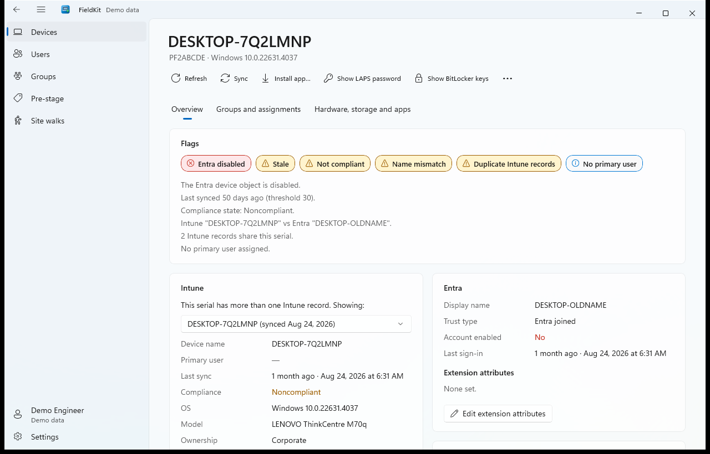
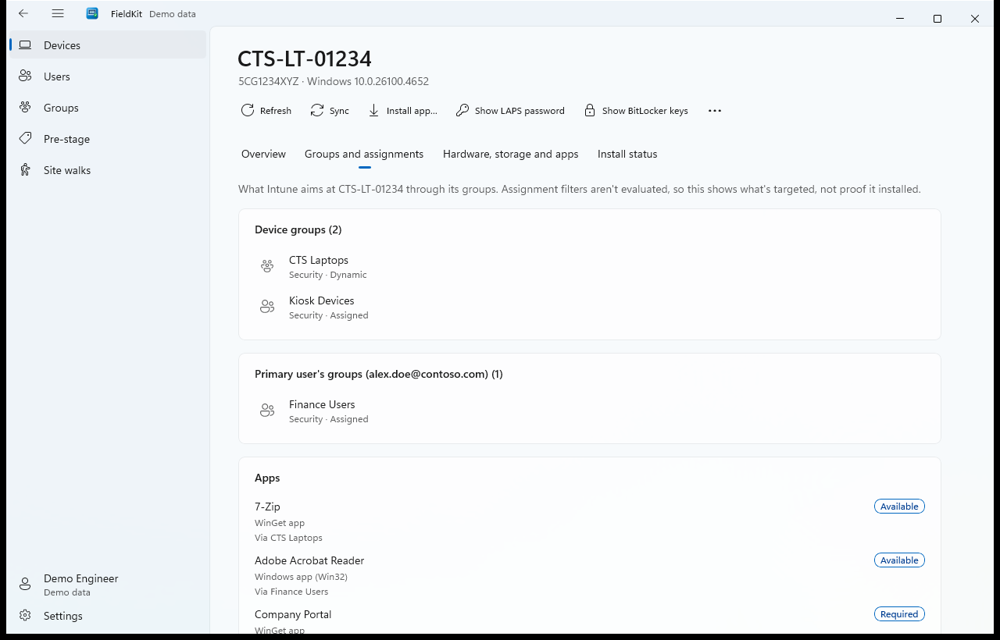
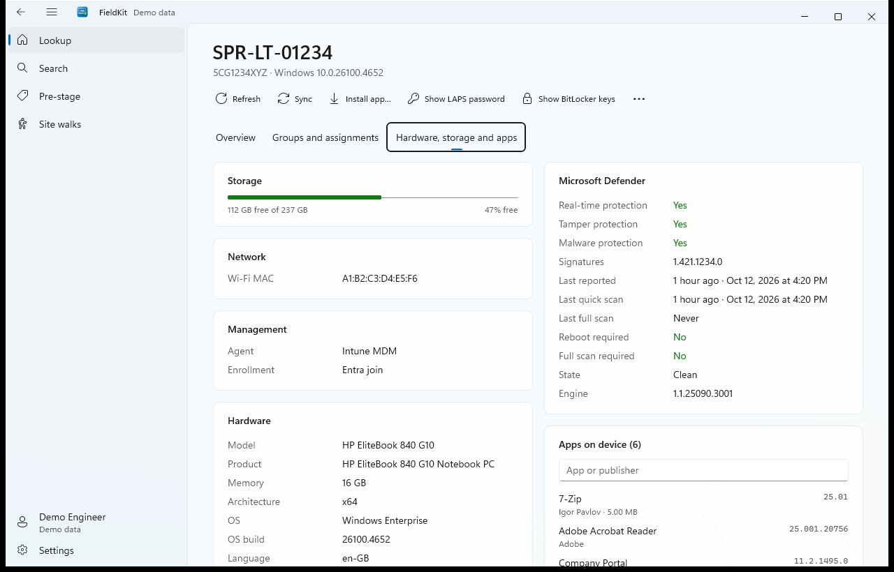
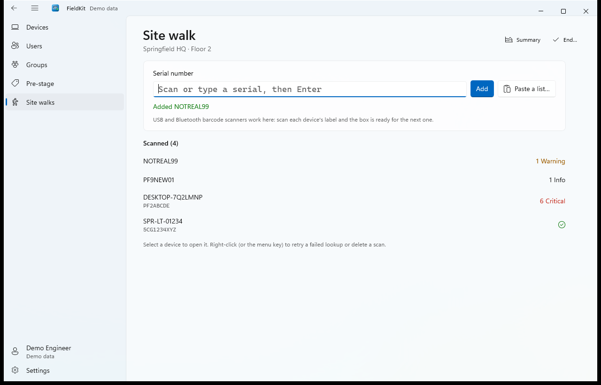
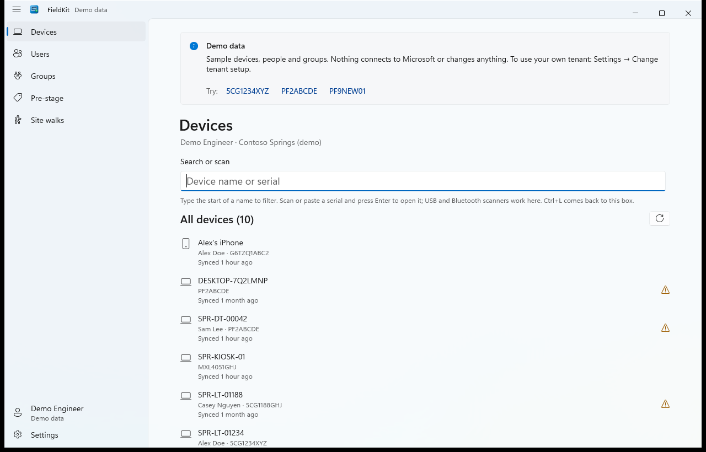
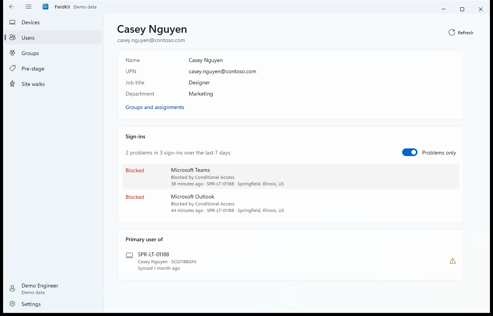
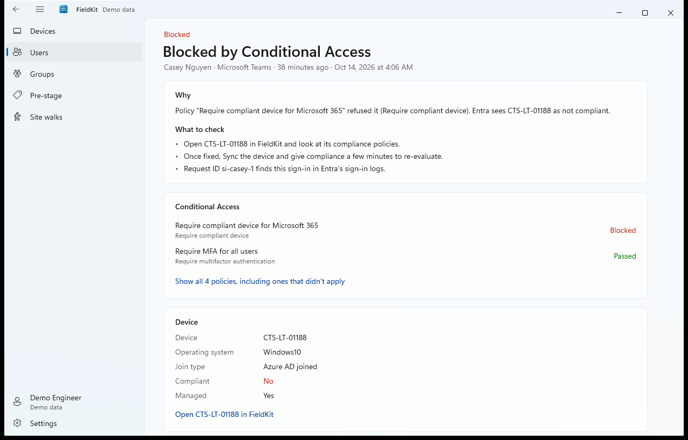
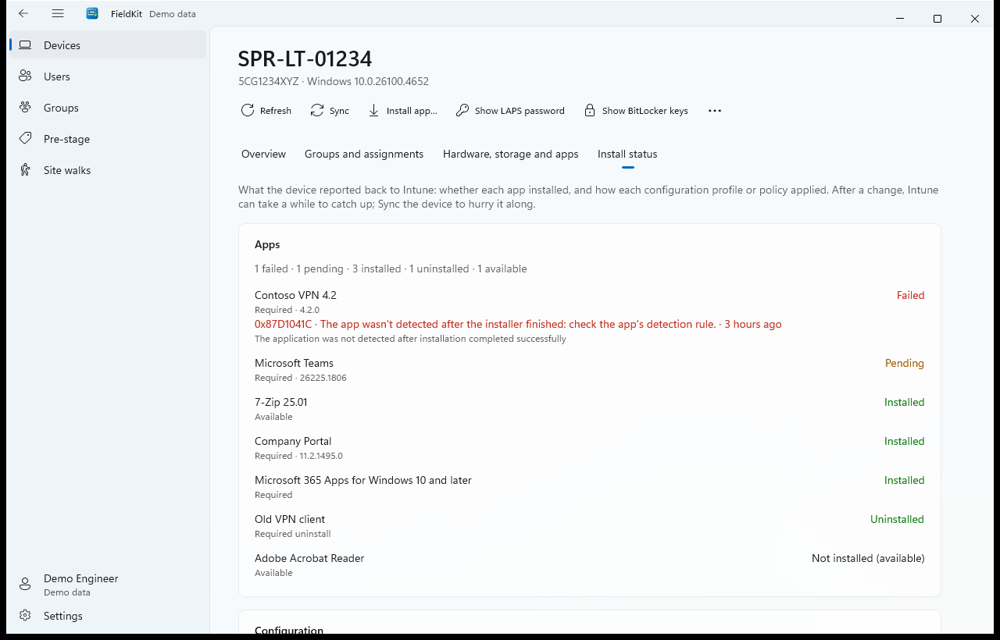

# FieldKit for Windows

Look up, fix and pre-stage devices in **Microsoft Intune, Entra ID and Autopilot**, from the PC you already work at.

Open it and your Intune devices are already listed, A–Z. Type to filter, scan or paste a serial number, or press **This PC**, and FieldKit shows the device's Intune, Entra and Autopilot records side by side, with problems flagged: not enrolled, stale, non-compliant, disabled in Entra, name mismatches, duplicate records and more. Then fix things on the spot.



## What it does

- **Look up any device** by serial: Intune, compliance policies, Entra and Autopilot, each loading on its own. USB and Bluetooth barcode scanners work in every serial box.
- **Devices, Users and Groups** tabs list your whole tenant A–Z as soon as they open and filter as you type. Open a person to see their devices, or a group to see what Intune targets at it and who's in it.
- **Groups and assignments**: which apps, profiles, policies, scripts and remediations reach a device (through its groups and its primary user's), including exclusions.
- **Hardware, storage and apps**: storage, memory, TPM, battery health, network, Microsoft Defender status and every detected app.
- **Install status**: did it actually install? Every app Intune targets at the device or its user, failed ones first with the error code and what it means, plus how each configuration profile and policy applied, errors and conflicts first.
- **Act on it**: sync, restart, retire, run a remediation, show the LAPS password or BitLocker keys, and install an app by adding the device or its user to the app's Required group. Restart, retire, remediations and recovery secrets ask for **Windows Hello** first.
- **Autopilot**: edit a device's group tag and assigned user, or tag box after box (or a pasted list) with **Pre-stage**.
- **Extension attributes**: see and edit a device's Entra extensionAttribute1–15, the ones dynamic groups and assignment filters use.
- **Why was I blocked?** A person's sign-ins from the last 7 days, problems first. Open one for a plain-English reason, what to check, which Conditional Access policy blocked it, and the device, one click from its FieldKit page.
- **Site walks**: scan every device in a room or floor, see what needs attention, and export a CSV that opens cleanly in Excel.
- **Demo mode**: try everything with sample data. Nothing connects to Microsoft.

| | |
|---|---|
|  |  |
|  |  |
|  |  |
|  | |

## Install

Download the latest release from [Releases](../../releases): Windows 10 (2004 or later) or Windows 11, x64 or ARM64.

- **MSI** (`FieldKit-<version>-x64.msi` or `-arm64.msi`): installs for everyone on the PC into `Program Files\FieldKit`, with a Start menu shortcut. Needs admin rights.
- **Zip** (`FieldKit-<version>-x64.zip` or `-arm64.zip`): unzip anywhere and run `FieldKit.exe`. No install or admin rights needed.

Everything FieldKit needs (.NET and the Windows App SDK) is included.

FieldKit isn't code-signed yet, so the first time you run a downloaded copy Windows SmartScreen may say it "protected your PC". Select **More info → Run anyway**. You can check a download against `SHA256SUMS.txt` in the release:

```powershell
Get-FileHash .\FieldKit-1.0.0-x64.msi -Algorithm SHA256
```

### Deploy with Intune

Add the MSI as a **Line-of-business app**, or wrap it as a **Win32 app** with:

- Install: `msiexec /i FieldKit-1.0.0-x64.msi /qn`
- Uninstall: `msiexec /x FieldKit-1.0.0-x64.msi /qn` (or by product code)
- Detection: MSI product code, or the file `%ProgramFiles%\FieldKit\FieldKit.exe` at version 1.0.0 or later.

New versions upgrade in place.

## Set up (once per tenant)

FieldKit signs in with each engineer's own work account and can only do what their Intune and Entra roles allow. An Entra admin registers it once, about 10 minutes:

1. **Entra admin center → App registrations → New registration.** Name it "FieldKit", single tenant, no redirect URI yet. (Already registered FieldKit for iPhone? Use the same registration and skip to step 2.)
2. **Authentication → Add a platform → Mobile and desktop applications**, and add this redirect URI with your Application (client) ID:
   `ms-appx-web://microsoft.aad.brokerplugin/<client ID>`
3. **API permissions → Microsoft Graph → Delegated**, add these, then **Grant admin consent**:

   | Permission | For |
   |---|---|
   | User.Read | Sign-in and profile |
   | User.Read.All | List and search people |
   | DeviceManagementManagedDevices.Read.All | Intune devices |
   | DeviceManagementConfiguration.Read.All | Compliance policy details, configuration status |
   | Device.Read.All | Entra devices |
   | DeviceManagementServiceConfig.ReadWrite.All | Autopilot lookup and pre-staging |
   | DeviceManagementManagedDevices.PrivilegedOperations.All | Sync, restart, retire, run remediations |
   | DeviceLocalCredential.Read.All | LAPS passwords |
   | BitlockerKey.Read.All | BitLocker recovery keys |
   | GroupMember.Read.All | Groups and memberships |
   | DeviceManagementApps.Read.All | App assignments and install status |
   | DeviceManagementScripts.Read.All | Scripts and remediations |
   | AuditLog.Read.All | Sign-in logs: why was I blocked? |
   | Policy.Read.ConditionalAccess | Which Conditional Access policies applied to a sign-in |
   | GroupMember.ReadWrite.All | Install apps, add and remove group members |
   | Directory.AccessAsUser.All | *Optional:* edit device extension attributes |

   Directory.AccessAsUser.All is only needed to edit extension attributes, and is the only permission Microsoft offers for changing a device as a signed-in user. It lets FieldKit do what your own Entra role allows, so leave it out if you don't need that feature. Editing also needs the Intune Administrator role.

   **Upgrading?** These versions added permissions. Add them, grant admin consent, then in FieldKit open **Settings → Permissions → Refresh sign-in** (consent can take a minute or two to reach new sign-ins):

   | Version | Added | For |
   |---|---|---|
   | 1.3.0 | AuditLog.Read.All, Policy.Read.ConditionalAccess | Why was I blocked? (sign-in logs and the Conditional Access policies in them) |
   | 1.2.0 | Directory.AccessAsUser.All *(optional)* | Editing device extension attributes |

   Other versions, including 1.4.0's install status, use permissions FieldKit already had.

   Until a permission is added, only the feature that needs it is affected; it says which permission and role it's missing. **Settings → Permissions** shows what the current sign-in has.

4. Open FieldKit, enter the **Directory (tenant) ID** and **Application (client) ID** from the registration's Overview page, and sign in. FieldKit's setup screen shows these steps too, and can copy them for an admin.

### Roles your engineers need

The permissions above say what FieldKit may ask for; each engineer's own roles decide what they actually get. Intune roles can be scoped with scope tags as usual.

| Feature | Role (or a custom role with the same rights) |
|---|---|
| Look up devices, compliance, groups, assignments and install status | Any Intune role that can read devices, policies and apps, such as Read Only Operator |
| Sync, restart, retire | Intune role with remote tasks, such as Help Desk Operator |
| Run a remediation | Intune role that can run remediations, plus Windows licences that include Remediations |
| Autopilot group tag and user, Pre-stage | Intune role that can update Autopilot devices, such as Policy and Profile Manager |
| Show LAPS password | Entra role that can read LAPS passwords, such as Cloud Device Administrator |
| Show BitLocker keys | Entra role that can read BitLocker keys, such as Cloud Device Administrator or Helpdesk Administrator |
| Install apps, add and remove group members | Groups Administrator or Intune Administrator, or owner of the group |
| Edit extension attributes | Intune Administrator |
| Why was I blocked? (sign-in logs) | Reports Reader, Security Reader or Global Reader. Sign-in logs also need **Microsoft Entra ID P1 or P2** |
| …and which Conditional Access policy blocked it | Global Reader, Security Reader or Conditional Access Administrator (without one, sign-ins still show, but not the policies) |

LAPS, BitLocker, restart, retire and remediations also ask for **Windows Hello** on the PC first.

FieldKit is a public client: no client secret or certificate. It signs in through the Windows account broker, so on an Entra-joined PC it usually signs in without a prompt, and Conditional Access "require compliant device" works on Intune-managed PCs.

## Privacy

FieldKit collects nothing. It talks only to Microsoft sign-in and Microsoft Graph, as you. Sign-in tokens stay with Windows. On the PC it keeps your tenant setup, settings, recent lookups and site walks in `%LOCALAPPDATA%\FieldKit`; **Settings → Clear all local data** removes them.

LAPS passwords and BitLocker keys are shown only after Windows Hello, masked until you select Show, hidden when FieldKit loses focus, kept out of screenshots and screen sharing while shown, and closed after two minutes. Copying one keeps it out of clipboard history and cloud clipboard, and clears it after 60 seconds.

## Help

Questions and problems: [open an issue](../../issues).

FieldKit is made by YeomanLabs.

## License

[MIT](LICENSE). Free to use, copy and redistribute, including inside your organization. It comes as is, with no warranty.
